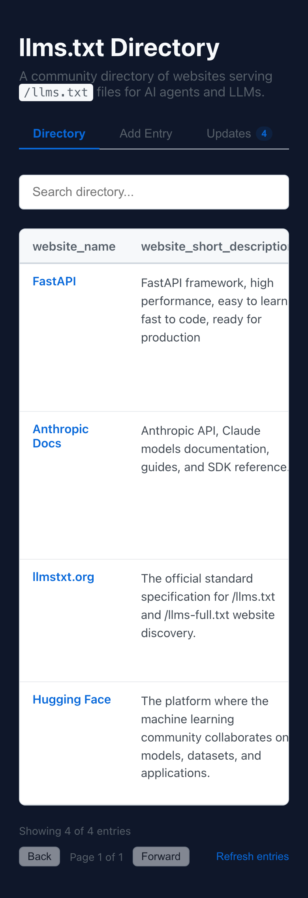
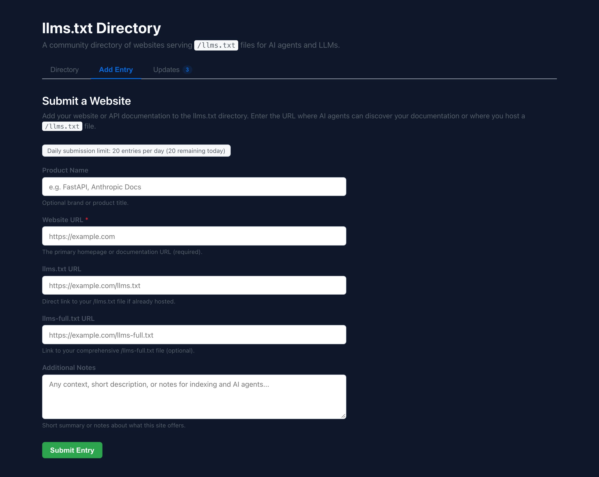
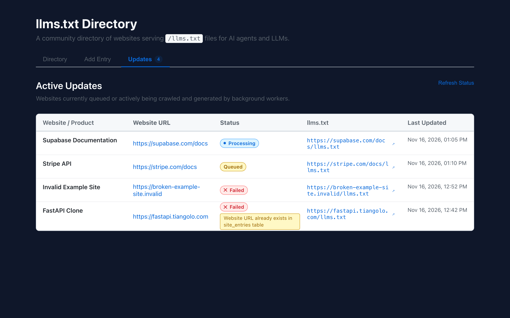
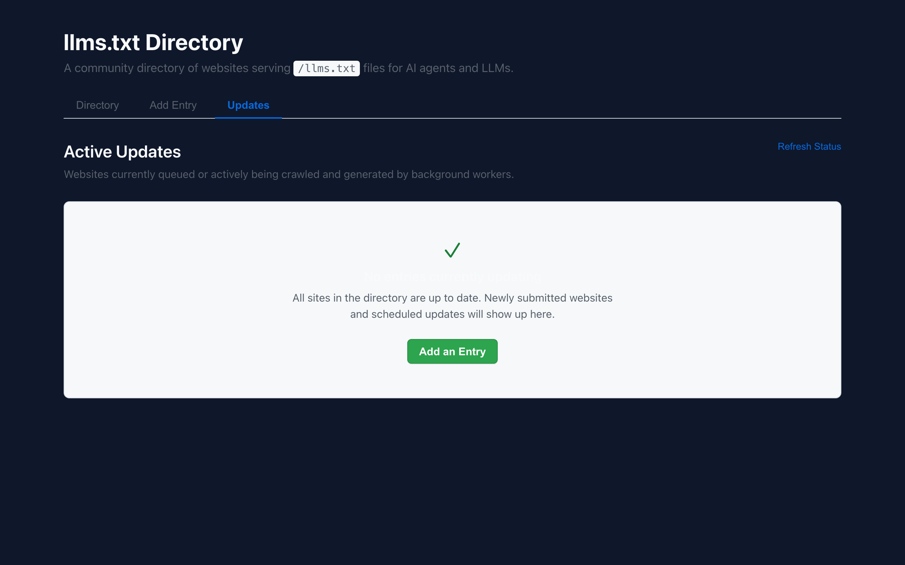
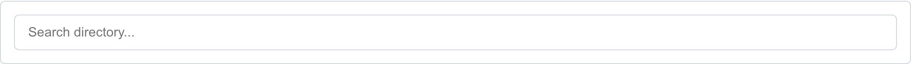
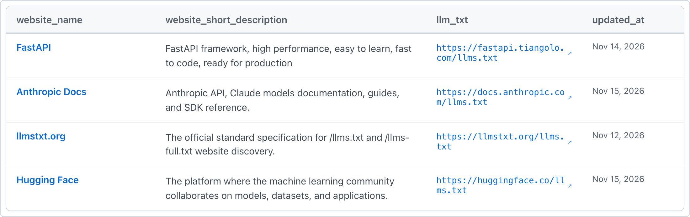
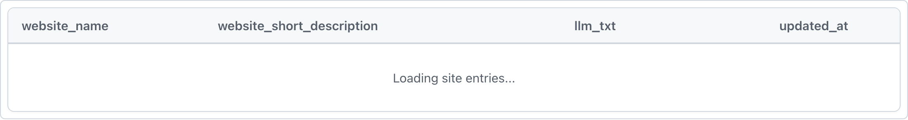
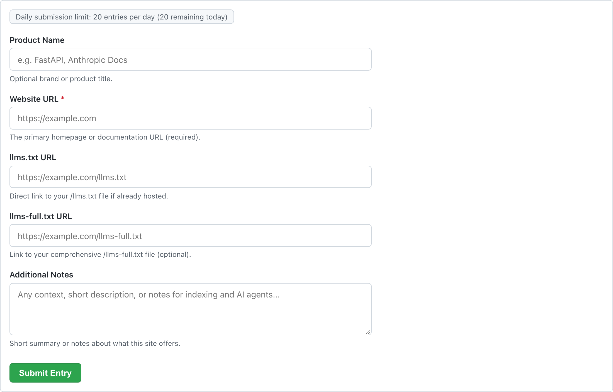
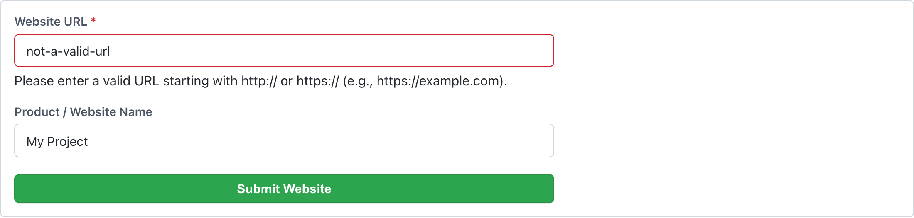

# llms-txt-ogechukwu-flagg-igbo

A production-grade monorepo for indexing, discovering, and serving standard-compliant `llms.txt` and `llms-full.txt` files for AI agents and LLMs.

---

## 📽️ End-to-End Test Recording

An automated Playwright E2E test suite exercises the entire user lifecycle in a visible (headed) browser against a local PostgreSQL database running in Docker:

* **Video Recording:** [Watch the E2E Flow Recording](recordings/e2e-playwright-flow.webm) (or inspect [`recordings/e2e-playwright-flow.webm`](recordings/e2e-playwright-flow.webm))
* **Playwright Flow Script:** [`scripts/e2e-playwright-flow.ts`](scripts/e2e-playwright-flow.ts)

### What the Playwright Flow Tests:
1. **Directory Initial Load & Seed Data**: Verifies navigation tabs (`Directory`, `Add Entry`, `Updates`) and checks seed records loaded from PostgreSQL (`FastAPI`, `Anthropic Docs`, `llmstxt.org`, `Hugging Face`).
2. **Real-time Search & Live Filtering**: Tests live substring query matching, handles non-matching queries with empty states, and verifies query resets.
3. **Hash-based Tab Routing**: Verifies hash synchronization across tabs (`#add`, `#updates`, `#`).
4. **Client-side Form Validation**: Asserts required field errors and protocol validation (`http://` or `https://`).
5. **Crawl & Generation Flow (`developer.mozilla.org`)**:
   * Submits a site that does not have an existing `/llms.txt`.
   * The background worker crawls the site, parses internal links and markdown documentation, formats standard `llms.txt` and `llms-full.txt` files, and marks the entry `COMPLETED` in PostgreSQL.
6. **Live Discovery Flow (`plaid.com/docs`)**:
   * Submits a site that already hosts an official `/llms.txt`.
   * The worker probes and detects the live file, validates compliance with the specification, saves it to storage, and completes the entry in PostgreSQL.
7. **Directory Table & Link Verification**: Refreshes the directory table, confirms entry count increases to 6, and verifies active `.txt` file links.
8. **Duplicate URL Rejection**: Re-submits a completed URL and verifies duplicate rejection in the updates queue.

### How to Run the E2E Tests:
```bash
# 1. Start local Docker PostgreSQL & Redis
npm run infra:up

# 2. Apply database migrations
npm run db:migrate

# 3. Run the Playwright E2E flow (headed browser + recording saved)
npm run test:e2e
```

---

## 📸 Frontend Visual Gallery & Screenshot Testing

Automated visual snapshots are captured for all components and pages using Playwright, tracked in Git to leverage **GitHub's native visual image diffing** (2-up, Swipe, Onion Skin, and Difference views).

### Full Pages

| Page | Desktop Preview (1280x800) | Mobile Preview (390x844) |
|---|---|---|
| **Directory (Home)** |  |  |
| **Add Entry Form** |  |  |
| **Background Updates** |  |  |
| **Search Filtered** |  | — |
| **Updates (Empty)** |  | — |

<details>
<summary><strong>🔍 Click to View Component Screenshots</strong></summary>

### Components

#### Navigation Tabs


#### Search Bar
| Default State | Active / Filled State |
|---|---|
|  |  |

#### Directory Cards
| Standard Card (Full Meta) | Minimal Card |
|---|---|
|  |  |

#### Directory Table
| Populated Table | Loading State | Empty / No Results |
|---|---|---|
|  |  |  |

#### Submission Form
| Empty Initial Form | Validation Error Feedback | Completed / Filled Form |
|---|---|---|
|  |  |  |

</details>

---

## 📁 Repository Structure

```text
├── apps/
│   ├── web/           # React 18 frontend with hash-based tabs, search, and submission form
│   ├── api/           # Node.js API Gateway (HTTP endpoints, rate limiter, local/R2 storage)
│   ├── worker/        # Async queue consumer (web scraper, llms.txt generator & validator)
│   └── cron-updater/  # Periodic scheduler polling sites based on adaptive cadence
├── packages/
│   ├── database/      # Database client, connection pool, and SQL migration files
│   ├── queue/         # Resilient in-memory and PostgreSQL SKIP LOCKED job queue with DLQ
│   ├── logger/        # Structured JSON logger with Sentry error monitoring
│   └── shared-types/  # Common TypeScript types shared across apps and packages
├── infra/
│   ├── docker-compose.yml # Local PostgreSQL 16 & Redis 7 development stack
│   └── terraform/     # Cloudflare R2 bucket and Render deployment infrastructure
├── recordings/        # Saved Playwright E2E test recordings (.webm)
├── screenshots/       # Deterministic visual regression snapshots for components and pages
└── scripts/           # Automation scripts (E2E testing, visual screenshot generation)
```

---

## 🛠️ Development Scripts

```bash
# Install dependencies
npm install

# Run unit tests across all workspaces
npm test

# Run Playwright E2E flow
npm run test:e2e

# Run component & page screenshot generation
npm run screenshots

# Run linter
npm run lint

# Run TypeScript typechecks
npm run typecheck

# Start individual development services
npm run dev:web     # React frontend on http://localhost:3000
npm run dev:api     # API server on http://localhost:4000
npm run dev:worker  # Queue worker consumer
npm run dev:cron    # Scheduled cadence updater
```
