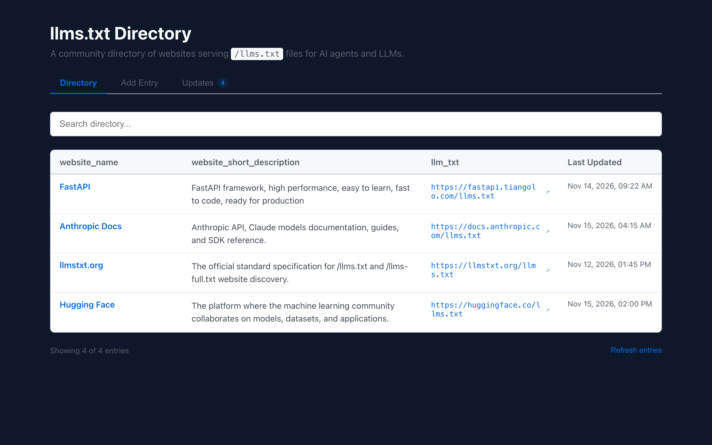
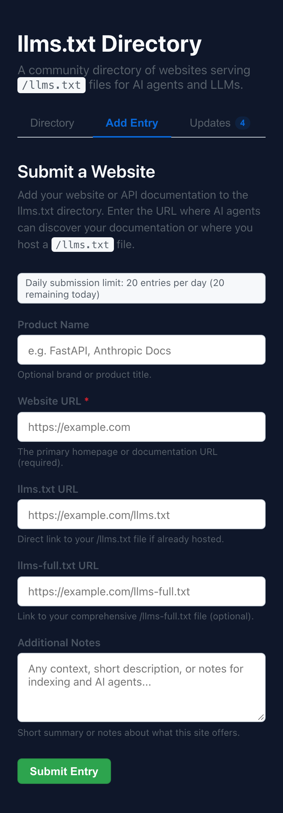
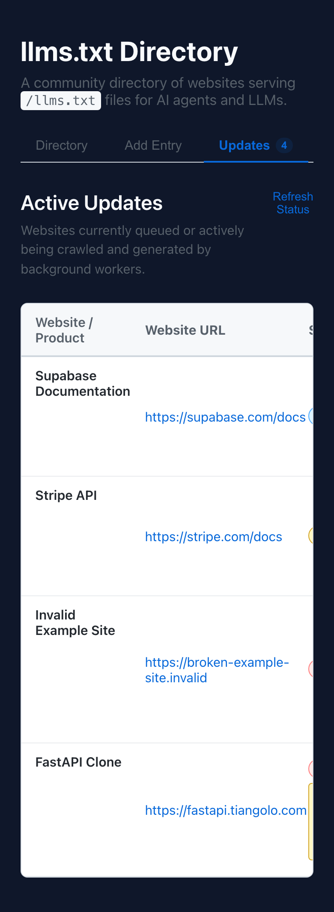
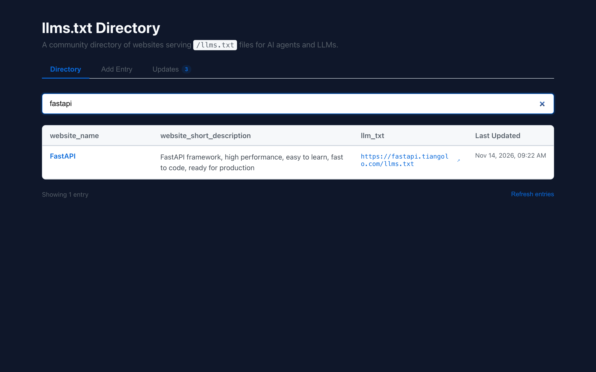
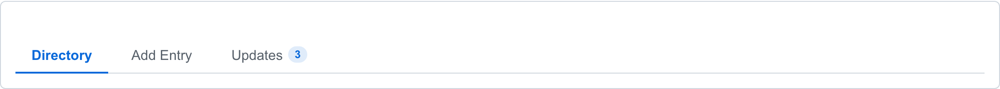
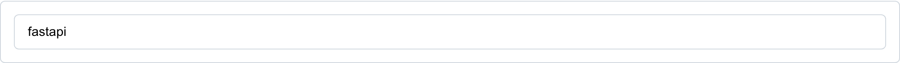
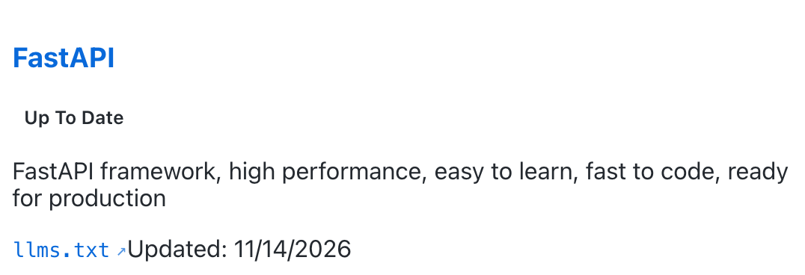
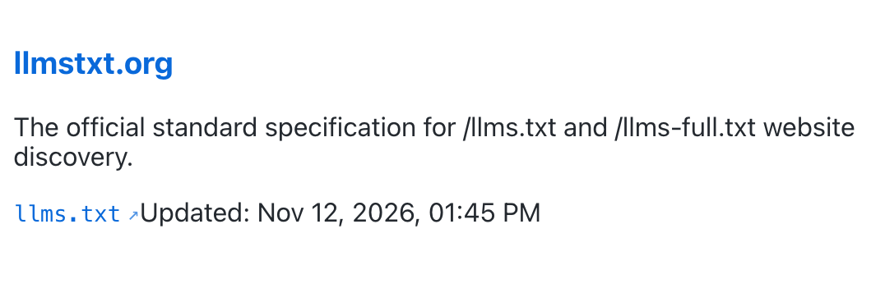
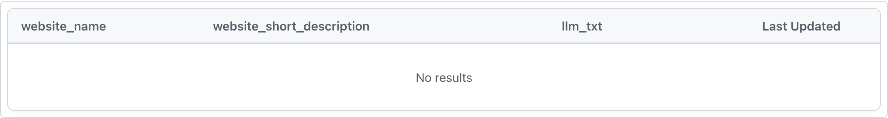
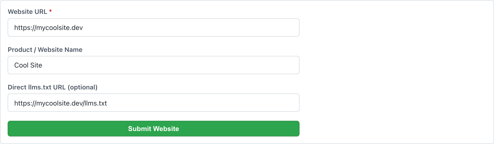

# llms-txt Directory Service

A monorepo for indexing, generating, and serving `llms.txt` and `llms-full.txt` files across developer websites and documentation hubs.

---

## 📸 Frontend Visual Gallery & Screenshot Testing

Automated Playwright visual snapshots are captured for all components and pages, tracked directly in Git to leverage **GitHub's native visual image diffing** (2-up, Swipe, Onion Skin, and Difference views on PRs and commits).

> 🔗 **Explore in Repository**:
> - [Browse `screenshots/` Directory on GitHub](https://github.com/FlaggIgbo/llms-txt-ogechukwu-flagg-igbo/tree/main/screenshots)
> - [View 20-Screenshot Commit on GitHub](https://github.com/FlaggIgbo/llms-txt-ogechukwu-flagg-igbo/commit/7167c0a86055274b0df84579b73c89c913bd740b)

### Full Pages

| Page | Desktop Preview (1280x800) | Mobile Preview (390x844) |
|---|---|---|
| **Directory (Home)** |  |  |
| **Add Entry Form** |  |  |
| **Background Updates** |  |  |
| **Search Filtered** |  | — |
| **Updates (Empty)** |  | — |

<details>
<summary><strong>🔍 Click to View Component Screenshots</strong></summary>

### Components

#### Navigation Tabs


#### Search Bar
| Default State | Active / Filled State |
|---|---|
|  |  |

#### Directory Cards
| Standard Card (Full Meta) | Minimal Card |
|---|---|
|  |  |

#### Directory Table
| Populated Table | Loading State | Empty / No Results |
|---|---|---|
|  |  |  |

#### Submission Form
| Empty Initial Form | Validation Error Feedback | Completed / Filled Form |
|---|---|---|
|  |  |  |

</details>

---

## 🔄 Automated Screenshot Updates on `git push`

This repository includes a Git pre-push hook (`.githooks/pre-push`) that runs on every `git push`:

1. **Change Detection**: Checks whether any frontend files in `apps/web/` or `packages/shared-types/` were modified in the outgoing commits.
2. **Automated Regeneration**: If frontend code changed, it spins up an ephemeral preview server and runs Playwright to regenerate all component and page snapshots deterministically.
3. **Auto-Commit**: If screenshot visual diffs are produced, it automatically stages and commits them (`chore(screenshots): regenerate component & page screenshots`).
4. **Instant Skip**: If no frontend files were touched (e.g. backend/worker code), the check completes immediately with zero delay.

### Manual Commands

```bash
# Regenerate all screenshots locally
npm run screenshots

# Run the pre-push screenshot verification check
npm run screenshots:check

# Skip screenshot generation during a push (if needed)
SKIP_SCREENSHOTS=1 git push
# or
git push --no-verify
```

---

## Structure

- `apps/web` — React frontend with Vite & responsive directory UI
- `apps/api` — Fastify API gateway
- `apps/worker` — Background queue crawler & llms.txt parser
- `apps/cron-updater` — Scheduled sync cron service
- `packages/` — Shared libraries (database, queue, logger, shared-types)
- `screenshots/` — Playwright visual snapshot baselines
- `infra/` — Docker Compose & cloud config

## Usage

1. Copy `.env.example` to `.env` and adjust values as needed.
2. Start local infrastructure (if needed) and install dependencies with `npm install`.
3. See `package.json` for available development, build, and test scripts.
